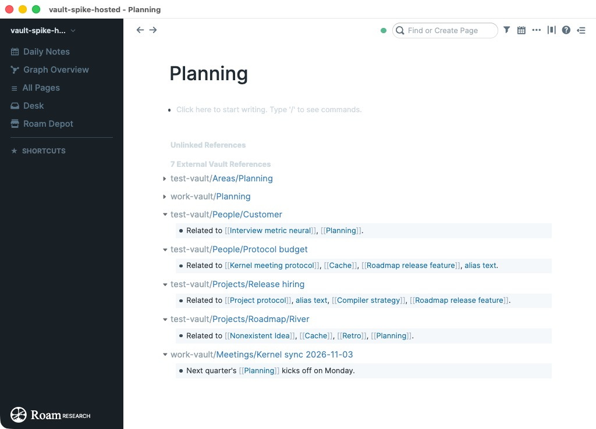
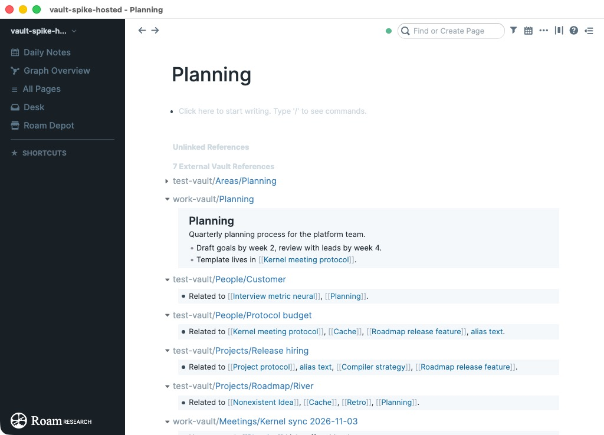
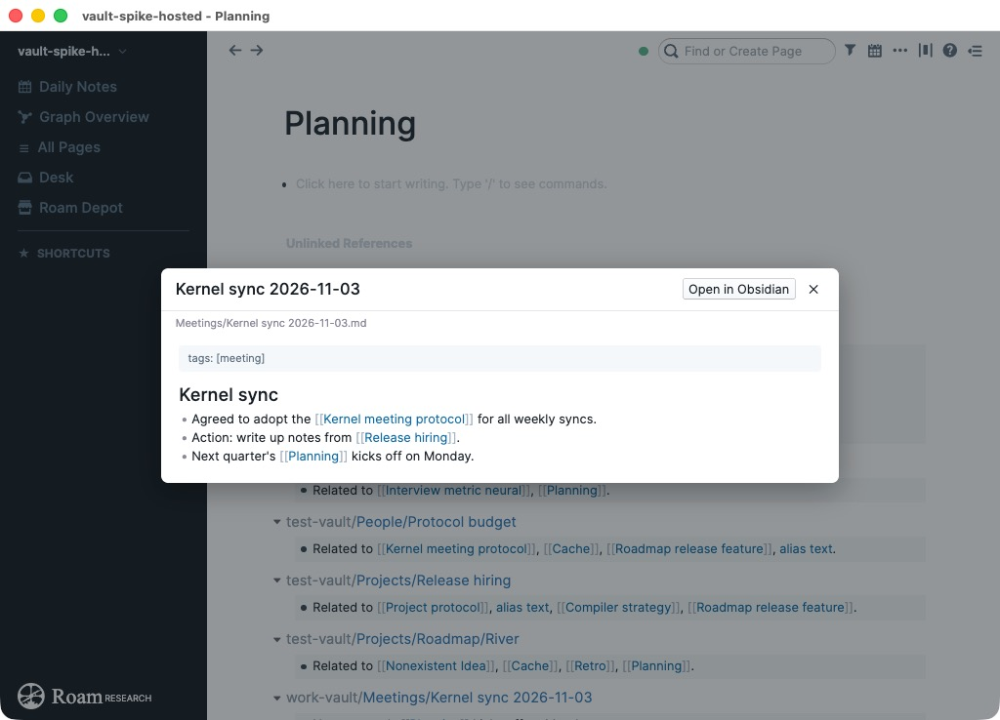

# Vaults

See notes from your Obsidian-style vaults in your Roam graph.

Vaults adds an **External Vault References** section to every Roam page. It sits below Linked and
Unlinked References and looks like them. It lists the notes in your Obsidian-style vaults, meaning local
folders of Markdown notes, that are about the page you're on or link to it.

It only reads your vault. Nothing from the vault is written to your Roam graph, and nothing is sent over the
network.

## What's an Obsidian-style vault?

A vault is just a folder of Markdown (`.md`) files on your computer, with subfolders, that link to each
other. [Obsidian](https://obsidian.md) made the idea popular. See
[How Obsidian stores data](https://help.obsidian.md/data-storage) for what a vault is, and
[Internal links](https://help.obsidian.md/links) and
[Obsidian Flavored Markdown](https://help.obsidian.md/obsidian-flavored-markdown) for the link and tag
syntax Vaults understands. You don't need Obsidian installed: any folder of Markdown notes works.

That includes **Open Knowledge Format (OKF)** bundles. [OKF](https://github.com/GoogleCloudPlatform/open-knowledge-format)
is an open format from Google Cloud for knowledge kept as plain Markdown files with YAML frontmatter
([spec](https://github.com/GoogleCloudPlatform/open-knowledge-format/blob/main/SPEC.md)). OKF uses standard
Markdown links, including bundle-absolute ones like `[Customers](/tables/customers.md)`, and Vaults follows
those as well as `[[wikilinks]]`.

## What it shows

One section covers every vault you add, and its count is the total across vaults. Notes are titled by
their path in the vault, such as `Projects/Kernel meeting protocol`. With more than one vault, the vault
name comes first in grey, such as `work-vault/Projects/Kernel meeting protocol`. The section lists three
kinds of notes, in this order:

- **The note that is this page**, listed first and folded. A note matches when it has the same name (in any
  letter case), lists the page title as an alias, sits at the same folder path (Roam `A/B` and `A/B.md`), or
  is the daily note for the same date. If several notes match, they're all shown. Click the caret to unfold
  the note and read it in place.
- **Notes that link here.** These are notes that link to the matching note, or contain `[[This Page]]` even
  when no such note exists. Links in frontmatter count too. Each linking line is shown like a Roam block.
- **Notes tagged here.** These are notes tagged `#this-page`, shown with the tag. A Roam namespace `a/b`
  matches the nested tag `#a/b`.

Click a note title or line to read the whole note in Roam. Links between notes work inside the viewer.
If you use Obsidian, click **Open in Obsidian** in the viewer to jump to the note there.

The section updates by itself. When you edit a note in Obsidian or any other editor, the change shows up in Roam within about a
second.

## Requirements

- **Roam desktop app** (tested on macOS). Roam in Chrome or Edge should also work, but the browser asks you to
  allow folder access again on each visit unless you choose "Allow on every visit". Other browsers and
  Roam's mobile apps can't read local folders (see [Mobile](#mobile)).
- A folder of Markdown (`.md`) files, such as an Obsidian vault or an OKF bundle. Obsidian vaults work
  best: daily-note formats, aliases and tags are read the way Obsidian reads them.

## Getting started

1. Install **Vaults** from Roam Depot.
2. Open any page. At the bottom, in the **External Vault References** section, click **Add vault folder**.
   You can also open the command palette (Cmd+P or Ctrl+P) and run
   **External Vault References: Add vault folder**.
3. Choose your vault folder and allow access when asked.

The first scan of a large vault takes a few seconds. After that, only changed files are read again.

### Choosing the right folder

Choose the vault folder itself, such as `Documents/My Vault`. Don't choose `Documents`, `Desktop`,
`Downloads` or your home folder. macOS protects those folders, and Roam can't open them. If that happens,
the extension tells you, and you need to quit and reopen Roam before you try again.

### Adding more than one vault

Hover the **External Vault References** header and click **Add vault**, or run
**External Vault References: Add vault folder** again. Notes from all your vaults appear in the same section,
each title starting with its vault's name.

### Removing a vault

Open the command palette and run **External Vault References: Remove vault "name"**. There's one such
command for each vault. To remove every vault at once, run **External Vault References: Remove all vaults**. Removing a vault makes Roam forget the folder and deletes
its cache. Your files aren't touched.

## Commands

| Command | What it does |
|---|---|
| External Vault References: Add vault folder | Adds a vault. Also on hover in the section header. |
| External Vault References: Rescan vaults | Reads every vault again. Only changed files are parsed. |
| External Vault References: Remove vault "name" | Forgets that vault and deletes its cache. One command per vault. |
| External Vault References: Remove all vaults | Forgets every vault on this computer. |

## Privacy

- **Read-only.** The extension reads your vault folder and never changes it. It never writes vault content
  into your Roam graph.
- **Stays on this computer.** The extension makes no network requests. Your vault folder, and the cache of
  parsed notes that makes later starts fast, are kept in the Roam app's storage on this computer. They aren't
  stored in your graph and don't sync to your other devices or to other people in a shared graph.
- **Folder access you control.** The extension can only read folders you choose. Removing a vault deletes
  its saved folder access and its cache of parsed notes.
- **Who sees the section.** The section is drawn on your screen only. Collaborators on a shared graph don't
  see your vault unless they install the extension and add a vault themselves.

## Mobile

Roam's mobile apps can't read folders on your phone, so External Vault References doesn't show on mobile in
this version.

A later version may add an opt-in **mobile snapshot**. Your desktop would upload a copy of the vault index
into your graph's file storage, and your phone would read that copy. It will be off unless you turn it on.
Before you turn it on, know this: Roam's file links aren't private. **Anyone who has the snapshot's link can
download it without signing in to Roam.** The link is hard to guess, but it's stored in your graph, so anyone
who can read your graph can find it, and you can't revoke a copy someone has already downloaded. Don't use the
snapshot for a vault you wouldn't want shared that way.

## Limits in this version

- Matching uses the exact rules above. Fuzzy or "similar title" matches aren't shown yet.
- Notes are shown as read-only previews. Edit them in Obsidian or your usual editor.
- Only `.md` files are read. Canvas files, PDFs and attachments are skipped.

## Feedback and source

Report problems or ideas at [github.com/sweenzor/roam-vaults/issues](https://github.com/sweenzor/roam-vaults/issues).
The source code, design notes and changelog are at
[github.com/sweenzor/roam-vaults](https://github.com/sweenzor/roam-vaults).
