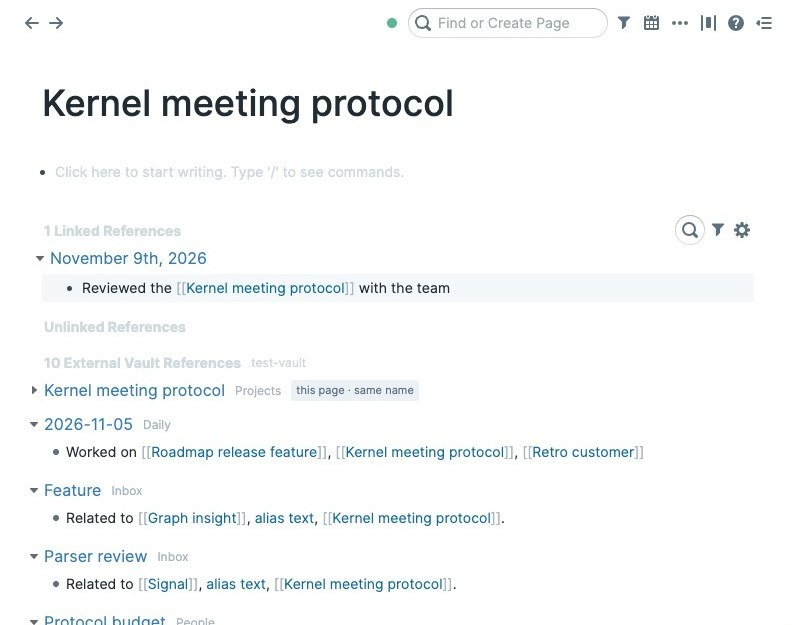
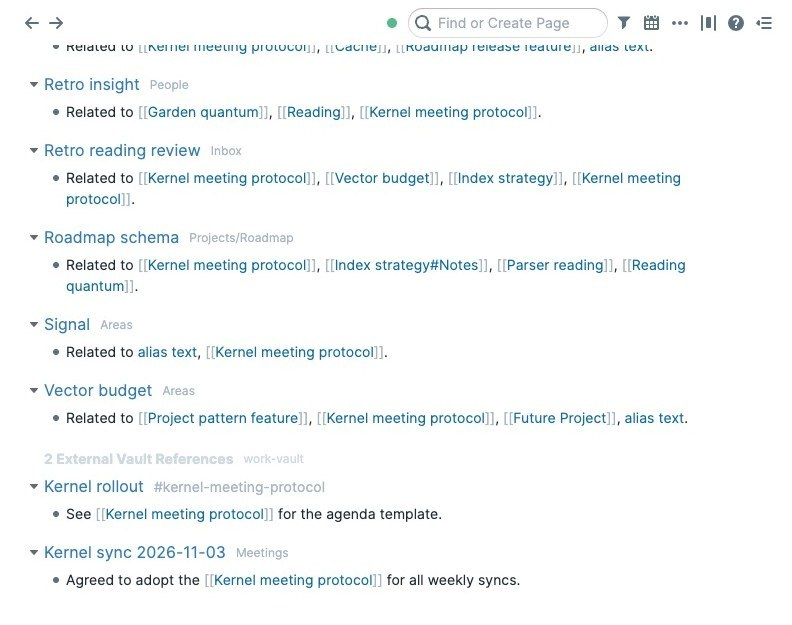

# External Vault References

See your Obsidian notes next to your Roam pages.

This extension adds an **External Vault References** section to every Roam page. It sits below Linked and
Unlinked References and looks like them. It lists the notes in a local Markdown folder, such as an Obsidian
vault, that are about the page you're on or link to it.

It only reads your vault. Nothing from the vault is written to your Roam graph, and nothing is sent over the
network.

## What it shows

Each vault you add gets its own section. Notes are titled by their path in the vault, such as
`Projects/Kernel meeting protocol`. A section lists three kinds of notes:

- **The note that is this page**, listed first and folded. A note matches when it has the same name (in any
  letter case), lists the page title as an alias, sits at the same folder path (Roam `A/B` and `A/B.md`), or
  is the daily note for the same date. If several notes match, they're all shown. Click the caret to unfold
  the note and read it in place.
- **Notes that link here.** These are notes that link to the matching note, or contain `[[This Page]]` even
  when no such note exists. Links in frontmatter count too. Each linking line is shown like a Roam block.
- **Notes tagged here.** These are notes tagged `#this-page`, shown with the tag. A Roam namespace `a/b`
  matches the nested tag `#a/b`.

Click a note title or line to read the whole note in Roam. Links between notes work inside the viewer.
Hover a note and click **Open in Obsidian** to jump to it there.

The section updates by itself. When you edit a note in Obsidian, the change shows up in Roam within about a
second.

## Requirements

- **Roam desktop app** (tested on macOS). Roam in Chrome or Edge should also work, but the browser asks you to
  allow folder access again on each visit unless you choose "Allow on every visit". Other browsers and
  Roam's mobile apps can't read local folders (see [Mobile](#mobile)).
- A folder of Markdown (`.md`) files. Obsidian vaults work best: daily-note formats, aliases and tags are
  read the way Obsidian reads them.

## Getting started

1. Install **External Vault References** from Roam Depot.
2. Open any page. At the bottom, in the **External Vault References** section, click **Add vault folder**.
   You can also open the command palette (Cmd+P or Ctrl+P) and run
   **External Vault References: Add vault folder**.
3. Choose your vault folder and allow access when asked.

The first scan of a large vault takes a few seconds. After that, only changed files are read again.

### Choosing the right folder

Choose the vault folder itself, such as `Documents/My Vault`. Don't choose `Documents`, `Desktop`,
`Downloads` or your home folder. macOS protects those folders, and Roam can't open them. If that happens,
the extension tells you, and you need to quit and reopen Roam before you try again.

### Adding more than one vault

Run **Add vault folder** again to add another vault. Each vault gets its own section, in the order you added
them.

### Removing a vault

Hover the vault's section header and click **Remove**. To remove every vault at once, run
**External Vault References: Remove all vaults**. Removing a vault only makes Roam forget the folder. Your
files aren't touched.

## Commands

| Command | What it does |
|---|---|
| External Vault References: Add vault folder | Adds a vault. Each vault gets its own section. |
| External Vault References: Rescan vaults | Reads every vault again. Only changed files are parsed. |
| External Vault References: Remove all vaults | Forgets every vault on this computer. |

## Privacy

- **Read-only.** The extension reads your vault folder and never changes it. It never writes vault content
  into your Roam graph.
- **Stays on this computer.** The extension makes no network requests. Your vault folder, and the cache of
  parsed notes that makes later starts fast, are kept in the Roam app's storage on this computer. They aren't
  stored in your graph and don't sync to your other devices or to other people in a shared graph.
- **Folder access you control.** The extension can only read folders you choose. Removing a vault deletes
  the saved folder access. The cache of parsed notes stays in Roam's local storage on this computer until
  you clear Roam's site data.
- **Who sees the section.** The section is drawn on your screen only. Collaborators on a shared graph don't
  see your vault unless they install the extension and add a vault themselves.

## Mobile

Roam's mobile apps can't read folders on your phone, so External Vault References doesn't show on mobile in
this version.

A later version may add an opt-in **mobile snapshot**. Your desktop would upload a copy of the vault index
into your graph's file storage, and your phone would read that copy. It will be off unless you turn it on.
Before you turn it on, know this: Roam's file links aren't private. **Anyone who has the snapshot's link can
download it without signing in to Roam.** The link is hard to guess, but it's stored in your graph, so anyone
who can read your graph can find it, and you can't revoke a copy someone has already downloaded. Don't use the
snapshot for a vault you wouldn't want shared that way.

## Limits in this version

- Matching uses the exact rules above. Fuzzy or "similar title" matches aren't shown yet.
- Notes are shown as read-only previews. Edit them in Obsidian.
- Only `.md` files are read. Canvas files, PDFs and attachments are skipped.

## Feedback and source

Report problems or ideas at [github.com/sweenzor/roam-vaults/issues](https://github.com/sweenzor/roam-vaults/issues).
The source code, design notes and changelog are at
[github.com/sweenzor/roam-vaults](https://github.com/sweenzor/roam-vaults).
